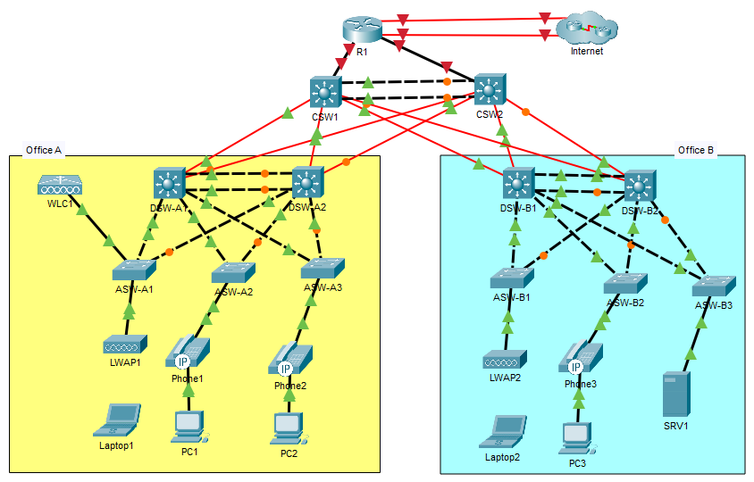

This is a documentation of me completing **Jeremy's IT lab**, mega lab. A lab that test every single concept and configuration you should know for your CCNA.

This network design will be a 3 tier architecture consisting of an Access, Distribution, and a Core layer.

If I use any commands I must put them in a code block under the task that I'm on. (Excluding user modes because that would take up of space and is unnecessary)

Here is the topology I will be working with:

*I will reference it in my documentation*

Jeremy did link a google spreadsheet as well, here is what that spreadsheet looks like:


*I may reference it in my documentation*

---
## Part 1 – Initial Setup 

**1.** Configure the appropriate hostname on each router/switch.

According to the spreadsheet provided, I will go to each router/switch and name them appropriately.

```
hostname <hostname>
```

**2.** Configure the enable secret **jeremysitlab** on each router/switch. Use type 9 hashing if available; otherwise, use type 5.  

The routers/switches that support type 9 encryption are:
- CSW1, CSW2
- DSW-A1, DSW-A2, DSW-B1, DSW-B2
To enable type 9 (scrypt) encryption, you must enter this command:
```
enable algorithm-type scrypt secret <password>
```

The routers/switches that could only use type 5 encryption are:
- R1
- ASW-A1, ASW-A2, ASW-A3, ASW-B1, ASW-B2, ASW-B3
To enable type 5 (md5) encryption, you must enter this command:
```
enable secret <password>
```

**3.** Configure the user account **cisco** with secret **ccna** on each router/switch. Use type 9 hashing if available; otherwise, use type 5.  

This step ties in with step 4 as well. I'll first need to create a username and password to grant access to the console port.

We can achieve this in the configuration terminal then creating the account with the following command:

MD5 Encryption (level 5)
```
(config)#username <username> secret <password> 
```

Scrypt Encryption (level 9)
```
(config)#username <username> algorithm-type scrypt secret <password> 
```

**4.** Configure the console line to require login with a local user account. Set a 30-minute inactivity timeout. Enable synchronous logging.

To require login authentication using the username and password login we created in the previous step, we will go to the port we want to apply this configuration to. In our case its the console port. 

We will need to issue the following command in the line console configuration:
```
(config-line)#login local
```

Next, we need to set a 30 minute timeout to prevent users leaving that door open.
```
(config-line)#exec-timeout <minutes>
```

Finally, we'll need to apply a synchronous logging
```
(config-line)#logging synchronous
```

---
## Part 2 – VLANs, Layer-2 EtherChannel

**1.** In Office A, configure a Layer-2 EtherChannel named **PortChannel1** between DSW-A1 and DSW-A2 using a Cisco-proprietary protocol. Both switches should actively try to form an EtherChannel.

To figure out which interfaces are connected between the two distribution switches we will use the show cdp neighbors command.

```
DSW-A1#show cdp neighbors
```

I was able to figure out the two interfaces then configured those interfaces as etherchannels using the **channel group** command with the **desirable** flag for PAGP configuration.

```
(config-if-range)#channel-group 1 mode desirable
```

**2.** In Office B, configure a Layer-2 EtherChannel named **PortChannel1** between DSW-B1 and DSW-B2 using an open standard protocol. Both switches should actively try to form an EtherChannel.

We will do the same steps as in step 1, just changing the etherchannel protocol to LACP

```
(config-if-range)#channel-group 1 mode active
```

**3.** Configure all links between Access and Distribution switches, including the EtherChannels, as trunk links.

**a.** Explicitly disable DTP on all ports.
**b.** Set each trunk’s native VLAN to VLAN 1000 (unused).
**c.** In Office A, allow VLANs 10, 20, 40, and 99 on all trunks.
**d.** In Office B, allow VLANs 10, 20, 30, and 99 on all trunks.

```
switchport mode trunk
switchport nonegotiate
switchport trunk native vlan 1000
switchport trunk allowed vlan 10,20,40,99
```
*Changed the 3rd VLAN to 30 for office B*

**4.** Configure one of each office’s Distribution switches as a VTPv2 server. Use domain name **JeremysITLab**.

a. Verify that other switches join the domain.
b. Configure all Access switches as VTP clients.

I will be configuring the DSW-A1 and DSW-B1 as the VTP servers by using this command:
```
vtp domain JeremysITLab
```

This allows us to copy the changes made to the VLANs on the distribution switch to the access switches when we configure them as VTP clients

All access switches in office A and B will be VTP clients to their respective VTP server:
```
vtp version 2
vtp mode client
```

I verified the access switches joined the domain by inputting this command:
```
show vtp status
```


**5.** In Office A, create and name the following VLANs on one of the Distribution switches. Ensure that VTP propagates the changes.

**a.** VLAN 10: PCs
**b.** VLAN 20: Phones
**c.** VLAN 40: Wi-Fi
**d.** VLAN 99: Management

```
vlan 10
name PCs
vlan 20
name Phones
vlan 40
name Wi-Fi
vlan 99
name Management
```

**6.** In Office B, create and name the following VLANs on one of the Distribution switches. Ensure that VTP propagates the changes.

**a.** VLAN 10: PCs 
**b.** VLAN 20: Phones 
**c.** VLAN 30: Servers
**d.** VLAN 99: Management

```
vlan 10
name PCs
vlan 20
name Phones
vlan 30
name Servers
vlan 99
name Management
```

We create VLANs to separate traffic for various reasons. For example, we isolate public Wi-Fi into a different subnet than our Management for security purposes. We don't want unauthorized personnel to access our companies infrastructure.

Another reason is for network traffic congestion. Think of it like a highway, if there was a highway that leads to 4 towns and the only way to get to these towns was through this one highway. That highway would have major traffic. However, if we were to make other roads to these other towns as well then the traffic would be much less congested.

**7.** Configure each Access switch’s access port. 

**a.** LWAPs will not use FlexConnect
**b.** PCs in VLAN 10, Phones in VLAN 20
**c.** SRV1 in VLAN 30
**d.** Manually configure access mode and explicitly disable DTP

```
interface f0/1
switchport mode access
switchport nonegotiate
switchport access vlan 10
switchport voice vlan 20
```

**8.** Configure ASW-A1’s connection to WLC1:

**a.** It must support the Wi-Fi and Management VLANs.
**b.** The Management VLAN should be untagged.
**c.** Disable DTP.

```
switchport mode trunk
switchport trunk allowed vlan 40,99
switchport native vlan 99
switchport nonegotiate
```

**9.** Administratively disable all unused ports on Access and Distribution switches.

```
show interfaces status
```

It's best practice to administratively shutdown all unused interfaces. We do this in case an attacker were to try to access our network through an interface, if the interface isn't being used then shut it down! We will add other precautions, like BPDU Guard, DHCP Snooping, DAI (Dynamic Arp Inspection) etc. This is just extra precaution!

All distribution switches:
```
interface range g1/0/6-24,g1/1/3-4
shutdown
```

All access switches: (except for ASW-A1 which is f0/3-24)
```
int range f0/2-24
shutdown
```

## Part 3 – IP Addresses, Layer-3 EtherChannel, HSRP

**1.** Configure the following IP addresses on R1’s interfaces and enable them:

> **a.** G0/0/0: DHCP client

```
ip address dhcp
```

> **b.** G0/1/0: DHCP client

```
ip address dhcp
```

> **c.** G0/0: 10.0.0.33/30

```
ip address 10.0.0.33 255.255.255.252
```

> **d.** G0/1: 10.0.0.37/30

```
ip address 10.0.0.37 255.255.255.252
```

> **e.** Loopback0: 10.0.0.76/32

```
int l0
ip address 10.0.0.76 255.255.255.255
```

**2.** Enable IPv4 routing on all Core and Distribution switches.

```
ip routing
```

You **must** enable this command otherwise Layer 3 traffic won't occur.

**3.** Create a Layer-3 EtherChannel between CSW1 and CSW2 using a Cisco-proprietary protocol. Both switches should actively try to form an EtherChannel. Configure the following IP addresses:

> **a.** CSW1 PortChannel1: 10.0.0.41/30

```
int range g1/0/2-3
no switchport
channel-group 1 mode desirable
int po1
ip address 10.0.0.41 255.255.255.252
```

> **b.** CSW2 PortChannel1: 10.0.0.42/30

```
int range g1/0/2-3
no switchport
channel-group 1 mode desirable
int po1
ip address 10.0.0.42 255.255.255.252
```

**4.** Configure the following IP addresses on CSW1. Disable all unused interfaces.

```
int range g1/0/4-24
shutdown
```

> **a.** G1/0/1: 10.0.0.34/30

```
int g1/0/1
no switchport
ip address 10.0.0.34 255.255.255.252
```

> **b.** G1/1/1: 10.0.0.45/30

```
int g1/1/1
no switchport
ip address 10.0.0.45 255.255.255.252
```

> **c.** G1/1/2: 10.0.0.49/30

```
int g1/1/2
no switchport
ip address 10.0.0.49 255.255.255.252
```

> **d.** G1/1/3: 10.0.0.53/30

```
int g1/1/3
no switchport
ip address 10.0.0.53 255.255.255.252
```

> **e.** G1/1/4: 10.0.0.57/30

```
int g1/1/4
no switchport
ip address 10.0.0.57 255.255.255.252
```

> **f.** Loopback0: 10.0.0.77/32

```
int l0
ip address 10.0.0.77 255.255.255.255
```

**5.** Configure the following IP addresses on CSW2. Disable all unused interfaces.

> **a.** G1/0/1: 10.0.0.38/30
> **b.** G1/1/1: 10.0.0.61/30
> **c.** G1/1/2: 10.0.0.65/30
> **d.** G1/1/3: 10.0.0.69/30
> **e.** G1/1/4: 10.0.0.73/30
> **f.** Loopback0: 10.0.0.78/32

```
int range g1/0/4-24
shutdown
int g1/0/1
no switchport
ip address 10.0.0.38 255.255.255.252
int g1/1/1
no switchport
ip address 10.0.0.61 255.255.255.252
int g1/1/2 
no switchport
ip address 10.0.0.65 255.255.255.252
int g1/1/3
no switchport
ip address 10.0.0.69 255.255.255.252
int g1/1/4
no switchport
ip address 10.0.0.73 255.255.255.252
int l0
ip address 10.0.0.78 255.255.255.255
```

**6.** Configure the following IP addresses on DSW-A1:

> **a.** G1/1/1: 10.0.0.46/30
> **b.** G1/1/2: 10.0.0.62/30
> **c.** Loopback0: 10.0.0.79/32

```
int g1/1/1
no switchport
ip address 10.0.0.46 255.255.255.252
int g1/1/2
no switchport 
ip address 10.0.0.62 255.255.255.252
int l0
ip address 10.0.0.79 255.255.255.255
```

**7.** Configure the following IP addresses on DSW-A2:

> **a.** G1/1/1: 10.0.0.50/30
> **b.** G1/1/2: 10.0.0.66/30 
> **c.** Loopback0: 10.0.0.80/32

```
int g1/1/1
no switchport
ip address 10.0.0.50 255.255.255.252
int g1/1/2
no switchport 
ip address 10.0.0.66 255.255.255.252
int l0
ip address 10.0.0.80 255.255.255.255
```

**8.** Configure the following IP addresses on DSW-B1:

> **a.** G1/1/1: 10.0.0.54/30
> **b.** G1/1/2: 10.0.0.70/30 
> **c.** Loopback0: 10.0.0.81/32

```
int g1/1/1
no switchport
ip address 10.0.0.54 255.255.255.252
int g1/1/2
no switchport 
ip address 10.0.0.70 255.255.255.252
int l0
ip address 10.0.0.81 255.255.255.255
```

**9.** Configure the following IP addresses on DSW-B2:

> **a.** G1/1/1: 10.0.0.58/30
> **b.** G1/1/2: 10.0.0.74/30
> **c.** Loopback0: 10.0.0.82/32

```
int g1/1/1
no switchport
ip address 10.0.0.58 255.255.255.252
int g1/1/2
no switchport
ip address 10.0.0.74 255.255.255.252
int l0
ip address 10.0.0.82 255.255.255.255
```

**10.** Manually configure SRV1’s IP settings:

> **a.** Default Gateway: 10.5.0.1
> **b.** IPv4 Address: 10.5.0.4
> **c.** Subnet Mask: 255.255.255.0


**11.** Configure the following management IP addresses on the Access switches (interface VLAN 99), and configure the appropriate subnet’s first usable address as the default gateway.

> **a.** ASW-A1: 10.0.0.4/28
```
ip default-gateway 10.0.0.1
int vlan 99
ip address 10.0.0.4 255.255.255.240
```
> **b.** ASW-A2: 10.0.0.5/28
```
ip default-gateway 10.0.0.1
int vlan 99
ip address 10.0.0.5 255.255.255.240
```
> **c.** ASW-A3: 10.0.0.6/28
```
ip default-gateway 10.0.0.1
int vlan 99
ip address 10.0.0.6 255.255.255.240
```
> **d.** ASW-B1: 10.0.0.20/28
```
ip default-gateway 10.0.0.17
int vlan 99
ip address 10.0.0.20 255.255.255.240
```
> **e.** ASW-B2: 10.0.0.21/28
```
ip default-gateway 10.0.0.17
int vlan 99
ip address 10.0.0.21 255.255.255.240
```
> **f.** ASW-B3: 10.0.0.22/28
```
ip default-gateway 10.0.0.17
int vlan 99
ip address 10.0.0.22 255.255.255.240
```

10.0.0.1 Office A

10.0.0.17 Office B

**12.** Configure HSRPv2 group 1 for Office A’s Management subnet (VLAN 99). Make DSW-A1 the Active router by increasing its priority to 5 above the default, and enable preemption on DSW-A1.

HSRP is a type of FHRP (First Hop Redundancy Protocol). FHRP works by creating a "VIP" (Virtual-IP) and using that as the default gateway for the subnet instead of an actual router. One router (by configuration) is the "Active" and the other is the "Standby" router (These terms vary depending on which FHRP you're using). FHRP also uses "Hello"  messages to give updates on the status of each other. For example, if the Standby router has not received any Hello messages from the Active router in a while, the Standby router will become the new Active router until the original Active router sends Hello messages again. (Note: You must activate "preemption" in the CLI for this to work.)

We're using HSRP because we can configure different active and standby routers for each VLAN.

> **a.** Subnet: 10.0.0.0/28
> **b.** VIP: 10.0.0.1
> **c.** DSW-A1: 10.0.0.2
> **d.** DSW-A2: 10.0.0.3

DSW-A1
```
int vlan 99
ip address 10.0.0.2 255.255.255.240
standby ver 2
standby 1 ip 10.0.0.1
standby 1 priority 105
standby 1 preempt
```

DSW-A2
```
int vlan 99
ip address 10.0.0.3 255.255.255.240
standby ver 2
standby 1 ip 10.0.0.1
```

Since we already configured priority on the DSW-A1 router, there's no need to mess with any other configuration on DSW-A2

**13.** Configure HSRPv2 group 2 for Office A’s PCs subnet (VLAN 10). Make DSW-A1 the Active router by increasing its priority to 5 above the default, and enable preemption on DSW-A1.

> **a.** Subnet: 10.1.0.0/24
> **b.** VIP: 10.1.0.1
> **c.** DSW-A1: 10.1.0.2
> **d.** DSW-A2: 10.1.0.3

DSW-A1
```
int vlan 10
ip address 10.1.0.2 255.255.255.0
standby ver 2
standby 2 ip 10.1.0.1
standby 2 priority 105
standby 2 preempt
```

DSW-A2
```
int vlan 10
ip address 10.1.0.3 255.255.255.0
standby ver 2
standby 2 ip 10.1.0.1
```

**14.** Configure HSRPv2 group 3 for Office A’s Phones subnet (VLAN 20). Make DSW-A2 the Active router by increasing its priority to 5 above the default, and enable preemption on DSW-A2.

> **a.** Subnet: 10.2.0.0/24
> **b.** VIP: 10.2.0.1
> **c.** DSW-A1: 10.2.0.2
> **d.** DSW-A2: 10.2.0.3

DSW-A1
```
int vlan 20
ip address 10.2.0.2 255.255.255.0
standby ver 2
standby 3 ip 10.2.0.1
```

DSW-A2
```
int vlan 20
ip address 10.2.0.3 255.255.255.0
standby ver 2
standby 3 ip 10.2.0.1
standby 3 priority 105
standby 3 preempt
```

**15.** Configure HSRPv2 group 4 for Office A’s Wi-Fi subnet (VLAN 40). Make DSW-A2 the Active router by increasing its priority to 5 above the default, and enable preemption on DSW-A2.

> **a.** Subnet: 10.6.0.0/24
> **b.** VIP: 10.6.0.1
> **c.** DSW-A1: 10.6.0.2
> **d.** DSW-A2: 10.6.0.3

DSW-A1
```
int vlan 40
ip address 10.6.0.2 255.255.255.0
standby ver 2
standby 4 ip 10.6.0.1
```

DSW-A2
```
int vlan 40
ip address 10.6.0.3 255.255.255.0
standby ver 2
standby 4 ip 10.6.0.1
standby 4 priority 105
standby 4 preempt
```

**16.** Configure HSRPv2 group 1 for Office B’s Management subnet (VLAN 99). Make DSW-B1 the Active router by increasing its priority to 5 above the default, and enable preemption on DSW-B1.

> **a.** Subnet: 10.0.0.16/28
> **b.** VIP: 10.0.0.17
> **c.** DSW-B1: 10.0.0.18
> **d.** DSW-B2: 10.0.0.19

DSW-B1
```
int vlan 99
ip address 10.0.0.18 255.255.255.240
standby ver 2
standby 1 ip 10.0.0.17
standby 1 priority 105
standby 1 preempt
```

DSW-B2
```
int vlan 99
ip address 10.0.0.19 255.255.255.240
standby ver 2
standby 1 ip 10.0.0.17
```

**17.** Configure HSRPv2 group 2 for Office B’s PCs subnet (VLAN 10). Make DSW-B1 the Active router by increasing its priority to 5 above the default, and enable preemption on DSW-B1.

> **a.** Subnet: 10.3.0.0/24
> **b.** VIP: 10.3.0.1
> **c.** DSW-B1: 10.3.0.2
> **d.** DSW-B2: 10.3.0.3

DSW-B1
```
int vlan 10
ip address 10.3.0.2 255.255.255.0
standby ver 2
standby 2 ip 10.3.0.1
standby 2 priority 105
standby 2 preempt
```

DSW-B2
```
int vlan 10
ip address 10.3.0.3 255.255.255.0
standby ver 2
standby 2 ip 10.3.0.1
```

**18.** Configure HSRPv2 group 3 for Office B’s Phones subnet (VLAN 20). Make DSW-B2 the Active router by increasing its priority to 5 above the default, and enable preemption on DSW-B2.

> **a.** Subnet: 10.4.0.0/24
> **b.** VIP: 10.4.0.1
> **c.** DSW-B1: 10.4.0.2
> **d.** DSW-B2: 10.4.0.3

DSW-B1
```
int vlan 20
ip address 10.4.0.2 255.255.255.0
standby ver 2
standby 3 ip 10.4.0.1
```

DSW-B2
```
int vlan 20
ip address 10.4.0.3 255.255.255.0
standby ver 2
standby 3 ip 10.4.0.1
standby 3 priority 105
standby 3 preempt
```

**19.** Configure HSRPv2 group 4 for Office B’s Servers subnet (VLAN 30). Make DSW-B2 the Active router by increasing its priority to 5 above the default, and enable preemption on DSW-B2.

> **a.** Subnet: 10.5.0.0/24
> **b.** VIP: 10.5.0.1
> **c.** DSW-B1: 10.5.0.2
> **d.** DSW-B2: 10.5.0.3

DSW-B1
```
int vlan 30
ip address 10.5.0.2 255.255.255.0
standby ver 2
standby 4 ip 10.5.0.1
```

DSW-B2
```
int vlan 30
ip address 10.5.0.3 255.255.255.0
standby ver 2
standby 4 ip 10.5.0.1
standby 4 priority 105
standby 4 preempt
```

---
## Part 4 – Rapid Spanning Tree Protocol

**1.** Configure Rapid PVST+ on all Access and Distribution switches.

> **a.** Ensure that the Root Bridge for each VLAN aligns with the HSRP Active router by configuring the lowest possible STP priority.
> **b.** Configure the HSRP Standby Router for each VLAN with an STP priority one increment above the lowest priority.

On all DST and ACC switches
```
spanning-tree mode rapid-pvst
```

DSW-A1
```
spanning-tree vlan 10,99 priority 0
spanning-tree vlan 20,40 priority 4096
```

DSW-A2
```
spanning-tree vlan 20,40 priority 0
spanning-tree vlan 10,99 priority 4096
```

DSW-B1
```
spanning-tree vlan 10,99 priority 0
spanning-tree vlan 20,30 priority 4096
```

DSW-B2
```
spanning-tree vlan 20,30 priority 0
spanning-tree vlan 10,99 priority 4096
```

**2.** Enable PortFast and BPDU Guard on all ports connected to end hosts (including WLC1). Perform the configurations in interface config mode.

ASW-A1
```
int f0/1
spanning-tree bpduguard enable
spanning-tree portfast
int f0/2
spanning-tree bpduguard enable
spanning-tree portfast trunk
```

ASW-A2
```
int f0/1
spanning-tree bpduguard enable
spanning-tree portfast
```

ASW-A3
```
int f0/1
spanning-tree bpduguard enable
spanning-tree portfast
```

ASW-B1
```
int f0/1
spanning-tree bpduguard enable
spanning-tree portfast
```

ASW-B2
```
int f0/1
spanning-tree bpduguard enable
spanning-tree portfast
```

ASW-B3
```
int f0/1
spanning-tree bpduguard enable
spanning-tree portfast
```

---
## Part 5 – Static and Dynamic Routing

**1.** Configure OSPF on R1 (LAN-facing interfaces) and all Core and Distribution switches (all Layer-3 interfaces).

> **a.** Use process ID 1 and Area 0.
> **b.** Manually configure each device’s RID to match the loopback interface IP.
> **c.** On switches, use the network command to match the exact IP address of each interface.
> **d.** On R1, enable OSPF in interface config mode.
> **e.** Make sure OSPF is enabled on all loopback interfaces, too. Loopback interfaces should be passive.
> **f.** Each Distribution switch’s SVIs (except the Management VLAN SVI) should be passive, too.
> **g.** Configure all physical connections between OSPF neighbors to use a network type that doesn’t elect a DR/BDR. NOTE: This doesn’t work on the Layer-3 PortChannel interfaces between CSW1/CSW2. Leave them as the default network type.

Router1
```
router ospf 1
passive-interface l 0
router-id 10.0.0.76
int l0
ip ospf 1 area 0
int range g0/0-1
ip ospf 1 area 0
ip ospf network point-to-point
```

CSW1
```
router ospf 1
router-id 10.0.0.77
passive-interface Loopback0
network 10.0.0.41 0.0.0.0 area 0
network 10.0.0.34 0.0.0.0 area 0
network 10.0.0.45 0.0.0.0 area 0
network 10.0.0.49 0.0.0.0 area 0
network 10.0.0.53 0.0.0.0 area 0
network 10.0.0.57 0.0.0.0 area 0
network 10.0.0.77 0.0.0.0 area 0
int range g1/0/1,g1/1/1-4
ip ospf network point-to-point
```

CSW2
```
router ospf 1
router-id 10.0.0.78
passive-interface Loopback0
network 10.0.0.42 0.0.0.0 area 0
network 10.0.0.38 0.0.0.0 area 0
network 10.0.0.61 0.0.0.0 area 0
network 10.0.0.65 0.0.0.0 area 0
network 10.0.0.69 0.0.0.0 area 0
network 10.0.0.73 0.0.0.0 area 0
network 10.0.0.78 0.0.0.0 area 0
int range g1/0/1,g1/1/1-4
ip ospf network point-to-point
```

DSW-A1
```
router ospf 1
router-id 10.0.0.79
passive-interface l0
passive-interface vlan 10
passive-interface vlan 20
passive-interface vlan 40
network 10.0.0.46 0.0.0.0 area 0
network 10.0.0.62 0.0.0.0 area 0
network 10.0.0.79 0.0.0.0 area 0
network 10.1.0.2 0.0.0.0 area 0
network 10.2.0.2 0.0.0.0 area 0
network 10.6.0.2 0.0.0.0 area 0
network 10.0.0.2 0.0.0.0 area 0
int range g1/1/1-2
ip ospf network point-to-point
```

DSW-A2
```
router ospf 1
router-id 10.0.0.80
passive-interface Loopback0
passive-interface Vlan10
passive-interface Vlan20
passive-interface Vlan40
network 10.0.0.50 0.0.0.0 area 0
network 10.0.0.66 0.0.0.0 area 0
network 10.0.0.80 0.0.0.0 area 0
network 10.1.0.3 0.0.0.0 area 0
network 10.2.0.3 0.0.0.0 area 0
network 10.6.0.3 0.0.0.0 area 0
network 10.0.0.3 0.0.0.0 area 0
int range g1/1/1-2
ip ospf network point-to-point
```

DSW-B1
```
router ospf 1
router-id 10.0.0.81
passive-interface Loopback0
passive-interface Vlan10
passive-interface Vlan20
passive-interface Vlan30
network 10.0.0.54 0.0.0.0 area 0
network 10.0.0.70 0.0.0.0 area 0
network 10.0.0.81 0.0.0.0 area 0
network 10.3.0.2 0.0.0.0 area 0
network 10.4.0.2 0.0.0.0 area 0
network 10.5.0.2 0.0.0.0 area 0
network 10.0.0.18 0.0.0.0 area 0
int range g1/1/1-2
ip ospf network point-to-point
```

DSW-B2
```
router ospf 1
router-id 10.0.0.82
passive-interface Loopback0
passive-interface Vlan10
passive-interface Vlan20
passive-interface Vlan30
network 10.0.0.58 0.0.0.0 area 0
network 10.0.0.74 0.0.0.0 area 0
network 10.0.0.82 0.0.0.0 area 0
network 10.3.0.3 0.0.0.0 area 0
network 10.4.0.3 0.0.0.0 area 0
network 10.5.0.3 0.0.0.0 area 0
network 10.0.0.19 0.0.0.0 area 0
int range g1/1/1-2
ip ospf network point-to-point
```

**2.** Configure one static default route for each of R1’s Internet connections. They should be recursive routes.

> **a.** Make the route via G0/1/0 a floating static route by configuring an AD value 1 greater than the default.
> **b.** R1 should function as an OSPF ASBR, advertising its default route to other routers in the OSPF domain.

We will use the "show ip interface" command on the interfaces connected to the ISP routers. We do this to find out our next hop address for configuring the recursive static route.

By seeing that interface g0/0/0 has the IP of "203.0.113.2/30" you can determine that the next hop IP is 203.0.113.1 because a /30 subnet mask only has 2 usable addresses and it cannot be 203.0.113.0 because that is the network defining address.

```
sh ip int g0/0/0
```


After finding out the next hop we can start to configure the default route.

```
ip route 0.0.0.0 0.0.0.0 203.0.113.1 
```

We will use the same show interface command as before to find that the other ISP interface's next hop IP is "203.0.113.5". 

We also need to add an AD at the end to make it a "floating static route" this acts as a backup to the other route in case there's an outage for the other interface, but shouldn't be used otherwise. The objective states we need to make the AD value 1 greater than the default. On cisco devices the default is 1, so therefore we need to make this route with an AD of 2.

```
ip route 0.0.0.0 0.0.0.0 203.0.113.5 2
```

Finally to give the rest of the devices internet access, we need Router 1 to advertise the default route to the other OSPF routers

```
router ospf 1
default-information originate
```

---
## Part 6 – Network Services: DHCP, DNS, NTP, SNMP, Syslog, FTP, SSH, NAT

**1.** Configure the following DHCP pools on R1 to make it serve as the DHCP server for hosts in Offices A and B. Exclude the first ten usable host addresses of each pool; they must not be leased to DHCP clients.

*All commands entered on R1*
```
ip dhcp excluded-address 10.0.0.1 10.0.0.10
ip dhcp excluded-address 10.1.0.1 10.1.0.10
ip dhcp excluded-address 10.2.0.1 10.2.0.10
ip dhcp excluded-address 10.3.0.1 10.3.0.10
ip dhcp excluded-address 10.4.0.1 10.4.0.10
ip dhcp excluded-address 10.6.0.1 10.6.0.10
ip dhcp excluded-address 10.0.0.17 10.0.0.26
ip domain-name jeremysitlab.com
```

> **a.** Pool: A-Mgmt
> > **i.** Subnet: 10.0.0.0/28
> > **ii.** Default gateway: 10.0.0.1
> > **iii.** Domain name: jeremysitlab.com
> > **iv.** DNS server: 10.5.0.4 (SRV1)
> > **v.** WLC: 10.0.0.7

```
ip dhcp pool A-Mgmt
network 10.0.0.0 255.255.255.240
default-router 10.0.0.1
domain-name jeremysitlab.com
dns-server 10.5.0.4
option 43 ip 10.0.0.7
```

> **b.** Pool: A-PC
> > **i.** Subnet: 10.1.0.0/24
> > **ii.** Default gateway: 10.1.0.1
> > **iii.** Domain name: jeremysitlab.com
> > **iv.** DNS server: 10.5.0.4 (SRV1)

```
ip dhcp pool A-PC
network 10.1.0.0 255.255.255.0
default-router 10.1.0.1
domain-name jeremysitlab.com
dns-server 10.5.0.4
```

> **c.** Pool: A-Phone
> > **i.** Subnet: 10.2.0.0/24
> > **ii.** Default gateway: 10.2.0.1
> > **iii.** Domain name: jeremysitlab.com
> > **iv.** DNS server: 10.5.0.4 (SRV1)

```
ip dhcp pool A-Phone
network 10.2.0.0 255.255.255.0
default-router 10.2.0.1
domain-name jeremysitlab.com
dns-server 10.5.0.4
```

> **d.** Pool: B-Mgmt
> > **i.** Subnet: 10.0.0.16/28
> > **ii.** Default gateway: 10.0.0.17
> > **iii.** Domain name: jeremysitlab.com
> > **iv.** DNS server: 10.5.0.4 (SRV1)
> > **v.** WLC: 10.0.0.7

```
ip dhcp pool B-Mgmt
network 10.0.0.16 255.255.255.240
default-router 10.0.0.17
domain-name jeremysitlab.com
dns-server 10.5.0.4
option 43 ip 10.0.0.7
```

> **e.** Pool: B-PC
> > **i.** Subnet: 10.3.0.0/24
> > **ii.** Default gateway: 10.3.0.1
> > **iii.** Domain name: jeremysitlab.com
> > **iv.** DNS server: 10.5.0.4 (SRV1)

```
ip dhcp pool B-PC
network 10.3.0.0 255.255.255.0
default-router 10.3.0.1
domain-name jeremysitlab.com
dns-server 10.5.0.4
```

> **f.** Pool: B-Phone
> > **i.** Subnet: 10.4.0.0/24
> > **ii.** Default gateway: 10.4.0.1
> > **iii.** Domain name: jeremysitlab.com
> > **iv.** DNS server: 10.5.0.4 (SRV1)

```
ip dhcp pool B-Phone
network 10.4.0.0 255.255.255.0
default-router 10.4.0.1
domain-name jeremysitlab.com
dns-server 10.5.0.4
```

> **g.** Pool: Wi-Fi
> > **i.** Subnet: 10.6.0.0/24
> > **ii.** Default gateway: 10.6.0.1
> > **iii.** Domain name: jeremysitlab.com
> > **iv.** DNS server: 10.5.0.4 (SRV1)

```
ip dhcp pool Wi-Fi
network 10.6.0.0 255.255.255.0
default-router 10.6.0.1
domain-name jeremysitlab.com
dns-server 10.5.0.4
```

**2.** Configure the Distribution switches to relay wired DHCP clients’ broadcast messages to R1’s Loopback0 IP address.

DSW-A1, DSW-A2
```
int vlan 10
ip helper-address 10.0.0.76
int vlan 20
ip helper-address 10.0.0.76
int vlan 40
ip helper-address 10.0.0.76
int vlan 99
ip helper-address 10.0.0.76
```

DSW-B1, DSW-B2
```
int vlan 10
ip helper-address 10.0.0.76
int vlan 20
ip helper-address 10.0.0.76
int vlan 30
ip helper-address 10.0.0.76
int vlan 99
ip helper-address 10.0.0.76
```

**3.** Configure the following DNS entries on SRV1:

> **a.** google.com = 172.253.62.100
> **b.** youtube.com = 152.250.31.93
> **c.** jeremysitlab.com = 66.235.200.145
> **d.** www.jeremysitlab.com = jeremysitlab.com

Server1


**4.** Configure all routers and switches to use domain name **jeremysitlab.com** and use SRV1 as their DNS server.

*On all routers/switches*
```
ip domain name jeremysitlab.com
ip name-server 10.5.0.4
```

**5.** Configure NTP on R1:

> **a.** Make R1 a stratum 5 NTP server.

```
ntp master 5
```

> **b.** R1 should learn the time from NTP server 216.239.35.0.

```
ntp server 216.239.35.0
```

> **c.** NOTE: NTP takes a LONG time to sync, especially in Packet Tracer. After making the configurations, you can move on – don’t wait for the devices to sync.

**6.** All Core, Distribution, and Access switches should use R1’s loopback interface as their NTP server. 

> **a.** Clients should authenticate R1 using key number **1** and the password **ccna**.

R1
```
ntp authentication-key 1 md5 ccna
ntp trusted-key 1
```

All routers/switches ***except*** R1
```
ntp authentication-key 1 md5 ccna
ntp trusted-key 1
ntp server 10.0.0.76 key 1
```

**7.** Configure the SNMP community string **SNMPSTRING** on all routers and switches. The string should allow GET messages, but not SET messages.

*All Switches and Routers*
```
snmp-server community SNMPSTRING ro
```

**8.** Configure Syslog on all routers and switches:

> **a.** Send Syslog messages to SRV1. Messages of all severity levels should be logged.
> **b.** Enable logging to the buffer. Reserve 8192 bytes of memory for the buffer.

```
logging 10.5.0.4
logging trap debugging
logging buffered 8192
```

**9.** Use FTP on R1 to download a new IOS version from SRV1:

> **a.** Configure R1’s default FTP credentials: username **cisco**, password **cisco**.

```
ip ftp user cisco
ip ftp pass cisco 
```

> **b.** Use FTP to copy the file **c2900-universalk9-mz.SPA.155-3.M4a.bin** from SRV1 to R1’s flash drive.

```
do copy ftp flash
10.5.0.4
c2900-universalk9-mz.SPA.155-3.M4a.bin
```

> **c.** Reboot R1 using the new IOS file, and then delete the old one from flash.

```
boot system flash c2900-universalk9-mz.SPA.155-3.M4a.bin
do wr
do reload
```

*After reboot*
```
show flash
delete flash c2900-universalk9-mz.SPA.151-4.M4.bin
```

**10.** Configure SSH for secure remote access on all routers and switches.

> **a.** Use the largest modulus size for the RSA keys.
> **b.** Allow SSHv2 connections only.

By default, on CiscoIOS the version of ssh allowed is "1.99" which means it allows versions 1 and 2. Version 2 is more secure and up to standards so we will change it to only accept SSHv2 connections.

> **c.** Create standard ACL 1, only allowing packets sourced from Office A’s PCs subnet. Apply the ACL to all VTY lines to restrict SSH access.

By only permitting the 10.1.0.0 subnet (Office A's PCs) the implicit deny will block all other IP addresses that don't match. 

We then configure the 'login local' command to authorize access with a login that matches the one we have configured for the console port. We enable logging as well for the same reasons. Finally, we configure the device to only allow SSH connections because it's way more secure than the outdated and **insecure** telnet 

> **d.** Allow only SSH connections to the VTY lines.
> 
> **e.** Require users to log in with a local user account when connecting via SSH.
> 
> **f.** Configure synchronous logging on the VTY lines.

*all routers/switches*
```
crypto key generate rsa
4096
ip ssh ver 2
access-list 1 permit 10.1.0.0 0.0.0.255
line vty 0 15
access-class 1 in
login local
transport input ssh
logging synchronous
```

**11.** Configure static NAT on R1 to enable hosts on the Internet to access SRV1 via the IP address **203.0.113.113**.

This should allows hosts to send packets to R1 and convert the private IP address to a global address so they can access devices outside of the LAN.

```
ip nat inside source static 10.5.0.4 203.0.113.113
int range g0/0/0,g0/1/0
ip nat outside
int range g0/0-1
ip nat inside
```

**12.** Configure pool-based dynamic PAT on R1 to enable hosts in the Office A PCs, Office A Phones, Office B PCs, Office B Phones, and Wi-Fi subnets to access the Internet.

> **a.** Use standard ACL 2 to define the appropriate inside local address ranges in the following order:
> > **i.** Office A PCs: 10.1.0.0/24
> > **ii.** Office A Phones: 10.2.0.0/24
> > **iii.** Office B PCs: 10.3.0.0/24
> > **iv.** Office B Phones: 10.4.0.0/24
> > **v.** Wi-Fi: 10.6.0.0/24

```
access-list 2 permit 10.1.0.0 0.0.0.255
access-list 2 permit 10.2.0.0 0.0.0.255
access-list 2 permit 10.3.0.0 0.0.0.255
access-list 2 permit 10.4.0.0 0.0.0.255
access-list 2 permit 10.6.0.0 0.0.0.255
```

> **b.** Define a range of inside global addresses called **POOL1**, specifying the range 203.0.113.200 to 203.0.113.207 with a /29 netmask.

```
ip nat pool POOL1 203.0.113.200 203.0.113.207 netmask 255.255.255.248
```

> **c.** Map ACL 2 to POOL1 and enable PAT. Confirm that hosts can access the Internet by pinging jeremysitlab.com.

Then we make sure to add 'overload' at the end to configure it as PAT, this allows ports to be used as well as the IP addresses.

```
ip nat inside source list 2 pool POOL1 overload
```

**13.** Disable CDP on all devices and enable LLDP instead. 

> **a.** Disable LLDP Tx on each Access switch’s access port (F0/1).

R1, Core switches, Distribution switches
```
no cdp run
lldp run
```

Access switches
```
no cdp run
lldp run
interface f0/1
no lldp transmit
```

---
## Part 7 – Security: ACLs and Layer-2 Security Features

**1.** Configure extended ACL **OfficeA_to_OfficeB** where appropriate:

> **a.** Allow ICMP messages from the **Office A PCs** subnet to the **Office B PCs** subnet. 
> **b.** Block all other traffic from the **Office A PCs** subnet to the **Office B PCs** subnet.
> **c.** Allow all other traffic.
> **d.** Apply the ACL according to general best practice for extended ACLs.

Best practice for extended ACLs is to apply them on the interface closest to the source. Where as a standard ACL the best practice is to apply them as close to the destination.

For this example we will apply the ACL to VLAN 10 on DSW-A1 and A2
```
ip access-list extended OfficeA_to_OfficeB
permit icmp 10.1.0.0 0.0.0.255 10.3.0.0 0.0.0.255
deny ip 10.1.0.0 0.0.0.255 10.3.0.0 0.0.0.255
permit ip any any
int vlan 10
ip access-group OfficeA_to_OfficeB in
```

**2.** Configure Port Security on each Access switch's F0/1 port:

> **a.** Allow the minimum necessary number of MAC addresses on each port.
> > **i.** SRV1 does not use virtualization, so it uses a single MAC address.
> **b.** Configure a violation mode that blocks invalid traffic without affecting valid traffic. The switches should send notifications when invalid traffic is detected.
> **c.** Switches should automatically save the secure MAC addresses they learn to the running-config.

ASW-A1, ASW-B1, ASW-B3
```
int f0/1
switchport port-security
switchport port-security violation restrict
switchport port-security mac-address sticky
```

Because these switches connect to IP phones and PCs, we need to make sure the maximum MAC addresses learned it only 2

ASW-A2, ASW-A3, ASW-B2
```
interface f0/1
switchport port-security
switchport port-security maximum 2
switchport port-security mac-address sticky
switchport port-security violation restrict
```

**3.** Configure DHCP Snooping on all Access switches.

> **a.** Enable it for all active VLANs in each LAN.
> **b.** Trust the appropriate ports.
> **c.** Disable insertion of DHCP Option 82.
> **d.** Set a DHCP rate limit of 15 pps on active untrusted ports.
> **e.** Set a higher limit (100 pps) on ASW-A1’s connection to WLC1.

Setting the PPS to 15 means that if that port receives DHCP packets at a rate greater than 15 packets per second then it will be err-disabled.

For ASW-A1 we did 100 pps rate since it's connected to the WLC.

ASW-A1
```
ip dhcp snooping
ip dhcp snooping vlan 10,20,40,99
no ip dhcp snooping information option
int range g0/1-2
ip dhcp snooping trust
int f0/1
ip dhcp snooping limit rate 15
int f0/2
ip dhcp snooping limit rate 100
```

ASW-A2, ASW-A3
```
ip dhcp snooping
ip dhcp snooping vlan 10,20,40,99
no ip dhcp snooping information option
int range g0/1-2
ip dhcp snooping trust
int f0/1
ip dhcp snooping limit rate 15
```

ASW-B1, ASW-B2, ASW-B3
```
ip dhcp snooping
ip dhcp snooping vlan 10,20,30,99
no ip dhcp snooping information option
int range g0/1-2
ip dhcp snooping trust
int f0/1
ip dhcp snooping limit rate 15
```

**4.** Configure DAI on all Access switches.

> **a.** Enable it for all active VLANs in each LAN.
> **b.** Trust the appropriate ports.
> **c.** Enable all optional validation checks.

ASW-A1, ASW-A2, ASW-A3
```
ip arp inspection vlan 10,20,40,99
ip arp inspection validate dst-mac src-mac ip
int range g0/1-2
ip arp inspection trust
```

ASW-B1, ASW-B2, ASW-B3
```
ip arp inspection vlan 10,20,30,99
ip arp inspection validate dst-mac src-mac ip
int range g0/1-2
ip arp inspection trust
```

---
## Part 8 – IPv6

**1.** To prepare for a migration to IPv6, enable IPv6 routing and configure IPv6 addresses on R1, CSW1, and CSW2:

> **a.** R1 G0/0/0: 2001:db8:a::2/64
> **b.** R1 G0/1/0: 2001:db8:b::2/64

R1, CSW1, CSW2
```
ipv6 unicast-routing
```

R1
```
ipv6 unicast-routing
int g0/0/0
ipv6 address 2001:db8:a::2/64
int g0/1/0
ipv6 address 2001:db8:b::2/64
```

> 
> **c.** R1 G0/0 and CSW1 G1/0/1: Use prefix 2001:db8:a1::/64 and EUI-64 to generate an interface ID for each interface.

R1
```
int g0/0
ipv6 address 2001:db8:a1::/64 eui-64
```

CSW1
```
int g1/0/1
ipv6 address 2001:db8:a1::/64 eui-64
```

> **d.** R1 G0/1 and CSW2 G1/0/1: Use prefix 2001:db8:a2::/64 and EUI-64 to generate an interface ID for each interface.

R1
```
int g0/1
ipv6 address 2001:db8:a2::/64 eui-64
```

CSW2
```
int g1/0/1
ipv6 address 2001:db8:a2::/64 eui-64
```

> **e.** CSW1 Po1 and CSW2 Po1: Enable IPv6 without using the ‘ipv6 address’ command.

CSW1, CSW2
```
int po1
ipv6 enable
```

**2.** Configure two default static routes on R1:

> **a.** A recursive route via next hop 2001:db8:a::1.
> **b.** A fully-specified route via next hop 2001:db8:b::1. Make it a floating route by configuring the AD 1 higher than default.

```
ipv6 route ::/0 2001:db8:a::1
ipv6 route ::/0 g0/1/0 2001:db8:b::1 2 
```

---
## Part 9 – Wireless

**1.** Access the GUI of WLC1 (https://10.0.0.7) from one of the PCs.

> **a.** Username: admin
> **b.** Password: adminPW12

I will access the WLC by going to the web browser of PC1 in Office A by entering it's IP address which is 10.0.0.7. Make sure to type the "s" in https otherwise it won't work.

**2.** Configure a dynamic interface for the Wi-Fi WLAN (10.6.0.0/24)

> **a.** Name: Wi-Fi
> **b.** VLAN: 40
> **c.** Port number: 1
> **d.** IP address: .4 of its subnet
> _Note: The Mega Lab video shows 10.6.0.2. This is a mistake, as it's a duplicate address of DSW-A1's VLAN 40 address._
> **e.** Gateway: .1 of its subnet
> **f.** DHCP server: 10.0.0.76

I'll go to the "controller tab" then "interfaces", then click "new". 


Then scroll down and configure the interface as requested.


**3.** Configure and enable the following WLAN:

> **a.** Profile name: Wi-Fi
> **b.** SSID: Wi-Fi
> **c.** ID: 1
> **d.** Status: Enabled
> **e.** Security: WPA2 Policy with AES encryption, PSK of cisco123

I'll shift over to the "WLANs" tab then click "create new" and input the SSID as well as the ID.


Then go to WLANs and click the "Wi-Fi" wlan we just created. Then go to the Security tab and enable WPA and WPA2 policy then click "WPA 2 Encryption" and finally make sure "AES" encryption is enabled.

The last step is to check the "PSK" box then add the password of "cisco123"


**4.** Verify that both LWAPs have associated with WLC1.

We can go to the "Wireless" tab and verify that both APs are associated with the WLC


